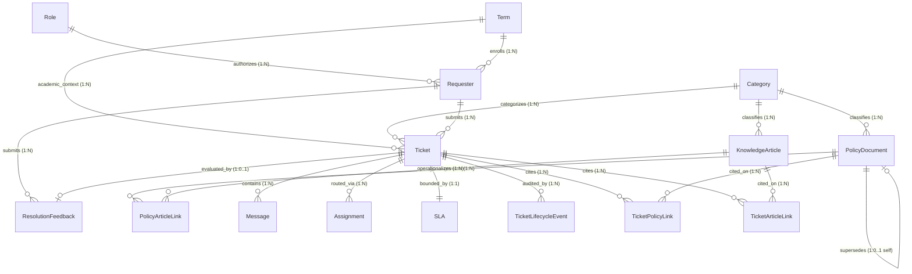
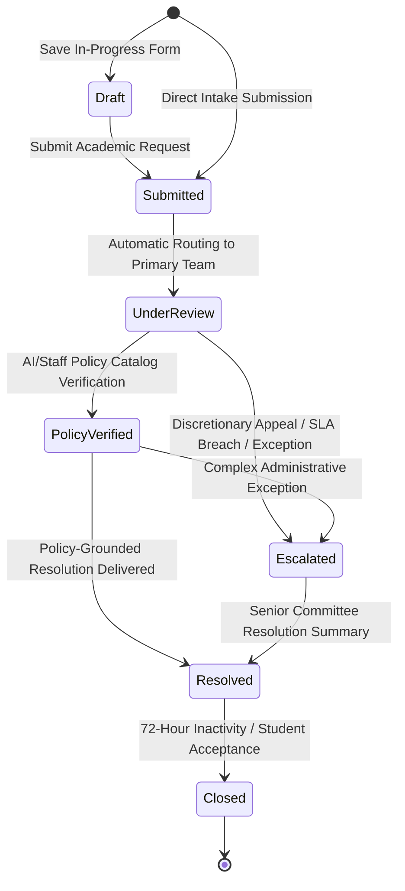

# CampusResolve AI — Official Data Dictionary

**System Version:** 2026.10-Phase4  
**Deterministic Random Seed:** `20261022`  
**Anchor Timestamp:** `2026-09-01T13:30:00+05:30` (ISO 8601 with explicit IST `+05:30` institutional timezone offset)  
**Total Volume:** 11 Core Entities | 5,000 Tickets | 20,000 Messages | 24 Policy Documents | 200 Knowledge Articles | 500 Requesters | 5 Roles | 4 Terms | 4 Categories | 5,399 Assignments | 5,000 SLAs | 2,667 Resolution Feedbacks  

---

## 1. Architectural & Timestamp Standards

### 1.1 Timestamp Convention (ISO 8601 with Explicit Timezone Offset)
All timestamp fields throughout the database, synthetic generation engine, and REST/WebSocket APIs adhere to strict ISO 8601 format with an explicit institutional offset:
- **Format:** `YYYY-MM-DDTHH:mm:ss+05:30`
- **Example:** `2026-09-01T13:30:00+05:30`
- **Rule:** Unqualified local timestamps without timezone offsets are prohibited. Date arithmetic and business-hour calculations (09:00–17:00 IST Monday through Friday, excluding institutional holidays) normalize all inputs through epoch milliseconds while preserving the explicit offset in persisted records.

### 1.2 Identifier Formats & RegEx Validation Rules
Every primary key follows an exact, human-readable format designed for deterministic sequence tracking and cross-table validation:

| Entity | ID Format Pattern | RegEx Validation Pattern | Example |
|---|---|---|---|
| **Requester** | `REQ-YYYY-NNNNNN` | `^REQ-\d{4}-\d{6}$` | `REQ-2026-000001` |
| **Role** | `ROLE-<UPPERCASE_CODE>` | `^ROLE-[A-Z_]+$` | `ROLE-LEARNER` |
| **Term** | `TERM-YYYY-<TERM_NAME>` | `^TERM-\d{4}-[A-Z]+$` | `TERM-2026-FALL` |
| **Category** | `CAT-<CODE>` | `^CAT-[A-Z]+$` | `CAT-FINAID` |
| **PolicyDocument** | `POL-<DOMAIN>-YYYY-NNN` | `^POL-[A-Z]+-\d{4}-\d{3}$` | `POL-FINAID-2026-001` |
| **KnowledgeArticle** | `KB-NNNNNN` | `^KB-\d{6}$` | `KB-000001` |
| **Ticket** | `TKT-YYYY-NNNNNN` | `^TKT-\d{4}-\d{6}$` | `TKT-2026-000001` |
| **Message** | `MSG-TKT-YYYY-NNNNNN-NNN` | `^MSG-TKT-\d{4}-\d{6}-\d{3}$` | `MSG-TKT-2026-000001-001` |
| **Assignment** | `ASG-TKT-YYYY-NNNNNN-NN` | `^ASG-TKT-\d{4}-\d{6}-\d{2}$` | `ASG-TKT-2026-000001-01` |
| **SLA** | `SLA-TKT-YYYY-NNNNNN` | `^SLA-TKT-\d{4}-\d{6}$` | `SLA-TKT-2026-000001` |
| **ResolutionFeedback** | `FDB-TKT-YYYY-NNNNNN` | `^FDB-TKT-\d{4}-\d{6}$` | `FDB-TKT-2026-000001` |
| **LifecycleEvent** | `EVT-TKT-YYYY-NNNNNN-NN` | `^EVT-TKT-\d{4}-\d{6}-\d{2}$` | `EVT-TKT-2026-000001-01` |
| **PolicyArticleLink** | `LNK-POL-KB-NNNNNN` | `^LNK-POL-KB-\d{6}$` | `LNK-POL-KB-000001` |
| **TicketPolicyLink** | `LNK-TKT-POL-NNNNNN` | `^LNK-TKT-POL-\d{6}$` | `LNK-TKT-POL-000001` |
| **TicketArticleLink** | `LNK-TKT-KB-NNNNNN` | `^LNK-TKT-KB-\d{6}$` | `LNK-TKT-KB-000001` |

---

## 2. Complete Field Specifications for All 11 Required Entities

### 2.1 Entity: Requester (`requesters`)
Represents an academic institutional actor (learner, instructor, researcher) who submits inquiries and petitions into the system.

| Field Name | Data Type | Req/Opt | Allowed Values | Units | Constraint | PK/FK | Referenced Entity & Field | Validation Rule | Description | Default Value |
|---|---|---|---|---|---|---|---|---|---|---|
| `requester_id` | `VARCHAR(32)` | Required | Format `REQ-YYYY-NNNNNN` | — | Unique | PK | — | Match `^REQ-\d{4}-\d{6}$` | Canonical primary identifier | None |
| `app_profile_id` | `UUID` | Optional | Valid UUID v4 | — | Nullable Unique | FK | `public.app_profiles.id` | Valid UUID format if present | Linked authenticated application profile | `NULL` |
| `role_id` | `VARCHAR(32)` | Required | `ROLE-LEARNER`, `ROLE-INSTRUCTOR` | — | Not Null | FK | `roles.role_id` | Foreign key exists in roles | Institutional requester role | `'ROLE-LEARNER'` |
| `primary_term_id` | `VARCHAR(32)` | Required | `TERM-2025-FALL`, `TERM-2026-FALL`, etc. | — | Not Null | FK | `terms.term_id` | Foreign key exists in terms | Primary academic term enrollment | `'TERM-2026-FALL'` |
| `verified_email` | `VARCHAR(255)` | Required | RFC 5322 synthetic email | — | Unique | — | Domain must be synthetic | Lowercase valid academic email | None |
| `display_name` | `VARCHAR(128)` | Required | Text length 3..128 | — | Not Null | — | Length >= 3 chars | Full name of requester | None |
| `department` | `VARCHAR(128)` | Required | Documented academic department | — | Not Null | — | Documented department list | Academic department or faculty | None |
| `program_or_unit` | `VARCHAR(128)` | Optional | Text length 2..128 | — | Nullable | — | — | Degree cohort, division, or unit | `NULL` |
| `account_status` | `VARCHAR(32)` | Required | `'active'`, `'inactive'`, `'suspended'` | — | Not Null | — | In allowed enum values | Operational account status | `'active'` |
| `is_synthetic_eval` | `BOOLEAN` | Required | `true`, `false` | — | Not Null | — | Boolean flag | Evaluation data shielding flag | `true` |
| `effective_from` | `VARCHAR(32)` | Required | ISO 8601 Date (`YYYY-MM-DD`) | Date | Not Null | — | Valid calendar date | Date account became effective | `'2026-08-01'` |
| `effective_to` | `VARCHAR(32)` | Optional | ISO 8601 Date or NULL | Date | Nullable | — | Must be >= effective_from | Expiration date of account | `NULL` |
| `created_at` | `VARCHAR(32)` | Required | ISO 8601 with `+05:30` | Time | Not Null | — | Valid ISO 8601 timestamp | Monotonic record creation time | Anchor ISO |
| `updated_at` | `VARCHAR(32)` | Required | ISO 8601 with `+05:30` | Time | Not Null | — | Must be >= created_at | Last record modification time | Anchor ISO |

---

### 2.2 Entity: Role (`roles`)
Defines the five institutional actor privileges, role-based access control (RBAC) scopes, and assignment capabilities.

| Field Name | Data Type | Req/Opt | Allowed Values | Units | Constraint | PK/FK | Referenced Entity & Field | Validation Rule | Description | Default Value |
|---|---|---|---|---|---|---|---|---|---|---|
| `role_id` | `VARCHAR(32)` | Required | Format `ROLE-<CODE>` | — | Unique | PK | — | Match `^ROLE-[A-Z_]+$` | Canonical primary role identifier | None |
| `role_code` | `VARCHAR(32)` | Required | `'learner'`, `'instructor'`, `'support_staff'`, `'academic_administrator'`, `'platform_administrator'` | — | Unique | — | In `ActorRole` enum | Lowercase programmatic actor role code | None |
| `role_name` | `VARCHAR(64)` | Required | Official human-readable name | — | Not Null | — | Non-empty string | Human-readable role title | None |
| `institutional_scope` | `VARCHAR(255)` | Required | Scope description | — | Not Null | — | Length >= 5 chars | Institutional jurisdiction scope | None |
| `description` | `TEXT` | Required | Detailed responsibilities | — | Not Null | — | Length >= 10 chars | Comprehensive role description | None |
| `allowed_actions` | `TEXT[]` | Required | Array of action strings | — | Not Null | — | Non-empty JSON/SQL array | Enumeration of authorized actions | `[]` |
| `can_be_assigned_tickets`| `BOOLEAN` | Required | `true`, `false` | — | Not Null | — | Staff/Admin only | Whether role can hold ticket queue assignments | `false` |
| `can_publish_policies` | `BOOLEAN` | Required | `true`, `false` | — | Not Null | — | Admin only | Authority to publish policy versions | `false` |
| `can_approve_escalations`| `BOOLEAN` | Required | `true`, `false` | — | Not Null | — | Admin only | Authority to adjudicate escalated appeals | `false` |
| `effective_from` | `VARCHAR(32)` | Required | ISO 8601 Date | Date | Not Null | — | Valid calendar date | Date role configuration became effective | `'2025-08-01'` |
| `effective_to` | `VARCHAR(32)` | Optional | ISO 8601 Date or NULL | Date | Nullable | — | Must be >= effective_from | Role deactivation date | `NULL` |
| `created_at` | `VARCHAR(32)` | Required | ISO 8601 with `+05:30` | Time | Not Null | — | Valid ISO 8601 timestamp | Role configuration creation timestamp | Anchor ISO |

---

### 2.3 Entity: Term (`terms`)
Defines the institutional academic calendar semesters, add/drop cutoffs, withdrawal deadlines, and aid disbursement milestones.

| Field Name | Data Type | Req/Opt | Allowed Values | Units | Constraint | PK/FK | Referenced Entity & Field | Validation Rule | Description | Default Value |
|---|---|---|---|---|---|---|---|---|---|---|
| `term_id` | `VARCHAR(32)` | Required | Format `TERM-YYYY-<NAME>` | — | Unique | PK | — | Match `^TERM-\d{4}-[A-Z]+$` | Canonical academic term identifier | None |
| `term_code` | `VARCHAR(16)` | Required | `'FA25'`, `'SP26'`, `'FA26'`, `'SP27'` | — | Unique | — | Alphanumeric code | Short institutional term code | None |
| `term_name` | `VARCHAR(64)` | Required | e.g. `'Fall 2026'` | — | Not Null | — | Non-empty string | Human-readable term description | None |
| `academic_year` | `INTEGER` | Required | e.g. `2025`, `2026`, `2027` | Year | Not Null | — | Range 2020..2035 | Academic calendar year integer | None |
| `start_date` | `VARCHAR(32)` | Required | ISO 8601 Date | Date | Not Null | — | Valid calendar date | Term instruction commencement date | None |
| `end_date` | `VARCHAR(32)` | Required | ISO 8601 Date | Date | Not Null | — | Must be > start_date | Term instruction conclusion date | None |
| `add_drop_deadline` | `VARCHAR(32)` | Required | ISO 8601 Date | Date | Not Null | — | Between start and end date | Final date for course schedule adjustments | None |
| `withdrawal_deadline` | `VARCHAR(32)` | Required | ISO 8601 Date | Date | Not Null | — | Must be > add_drop_deadline | Final date for standard course withdrawal | None |
| `aid_disbursement_date`| `VARCHAR(32)` | Required | ISO 8601 Date | Date | Not Null | — | Prior to start_date | Scheduled date for financial aid payout | None |
| `lifecycle_state` | `VARCHAR(32)` | Required | `'active'`, `'upcoming'`, `'archived'` | — | Not Null | — | In `TermLifecycleState` | Operational state of the academic term | None |
| `created_at` | `VARCHAR(32)` | Required | ISO 8601 with `+05:30` | Time | Not Null | — | Valid ISO 8601 timestamp | Term record creation timestamp | Anchor ISO |

---

### 2.4 Entity: PolicyDocument (`policy_documents`)
Stores authoritative institutional policy documents across all four domains, governing versions, and supersession lineages.

| Field Name | Data Type | Req/Opt | Allowed Values | Units | Constraint | PK/FK | Referenced Entity & Field | Validation Rule | Description | Default Value |
|---|---|---|---|---|---|---|---|---|---|---|
| `policy_id` | `VARCHAR(32)` | Required | Format `POL-<DOMAIN>-YYYY-NNN` | — | Unique | PK | — | Match `^POL-[A-Z]+-\d{4}-\d{3}$` | Canonical policy identifier | None |
| `domain` | `VARCHAR(16)` | Required | `'FINAID'`, `'REG'`, `'IT'`, `'ACCESS'` | — | Not Null | — | In `PolicyDomainCode` enum | Policy domain classification code | None |
| `category_id` | `VARCHAR(16)` | Required | `'CAT-FINAID'`, `'CAT-REG'`, `'CAT-IT'`, `'CAT-ACCESS'` | — | Not Null | FK | `categories.category_id` | Valid category foreign key | Associated operational category | None |
| `title` | `VARCHAR(255)` | Required | Text length 5..255 | — | Not Null | — | Non-empty descriptive title | Official title of policy document | None |
| `version` | `VARCHAR(16)` | Required | e.g. `'1.0'`, `'2.0'`, `'2.1'` | — | Not Null | — | Match `^\d+\.\d+(-[a-z]+)?$` | Semantic version string | None |
| `effective_date` | `VARCHAR(32)` | Required | ISO 8601 Date | Date | Not Null | — | Valid calendar date | Date policy entered legal authority | None |
| `expiration_date` | `VARCHAR(32)` | Optional | ISO 8601 Date or NULL | Date | Nullable | — | If present, must be > effective_date | Date policy authority expired | `NULL` |
| `lifecycle_state` | `VARCHAR(32)` | Required | `'draft'`, `'active'`, `'superseded'`, `'expired'` | — | Not Null | — | In `PolicyLifecycleState` | Authoritative publishing status | `'active'` |
| `supersedes_policy_id` | `VARCHAR(32)` | Optional | Policy ID or NULL | — | Nullable | FK (Self) | `policy_documents.policy_id` | Must point to earlier version | Policy ID superseded by this version | `NULL` |
| `superseded_by_policy_id` | `VARCHAR(32)` | Optional | Policy ID or NULL | — | Nullable | FK (Self) | `policy_documents.policy_id` | Must point to newer version | Policy ID that supersedes this version | `NULL` |
| `summary` | `TEXT` | Required | Text length >= 20 chars | — | Not Null | — | Non-empty structured summary | Executive overview of policy provisions | None |
| `content` | `TEXT` | Required | Full text length >= 50 chars | — | Not Null | — | Authoritative legal text | Full institutional policy text | None |
| `authoritative_section_ref` | `VARCHAR(64)` | Required | e.g. `'Section 4.2 (Current)'` | — | Not Null | — | Section reference | Authoritative section citation | None |
| `source_name` | `VARCHAR(128)` | Required | Source institution name | — | Not Null | — | Institutional source | Originating policy body | None |
| `source_url` | `VARCHAR(255)` | Required | Valid URN or URL | — | Not Null | — | Valid URI syntax | Provenance reference locator | None |
| `dataset_or_doc_version` | `VARCHAR(64)` | Required | Tracking version identifier | — | Not Null | — | Non-empty string | Document provenance build version | None |
| `retrieval_date` | `VARCHAR(32)` | Required | ISO 8601 Date | Date | Not Null | — | Valid calendar date | Date source document was ingested | `'2026-09-01'` |
| `license_terms` | `VARCHAR(128)` | Required | CC0-1.0 or institutional terms | — | Not Null | — | Open/synthetic terms | Governing reference license | `'CC0-1.0'` |
| `attribution` | `TEXT` | Required | Provenance attribution | — | Not Null | — | Non-empty text | Provenance attribution statement | None |
| `transformations_performed` | `TEXT` | Required | Transformation description | — | Not Null | — | Non-empty text | Document normalization operations | None |
| `discarded_fields` | `TEXT` | Optional | Discarded metadata list | — | Nullable | — | — | Unused original metadata fields | `NULL` |
| `is_synthetic_policy` | `BOOLEAN` | Required | `true`, `false` | — | Not Null | — | Boolean flag | Evaluation synthetic shield flag | `true` |
| `published_by_profile_id` | `UUID` | Optional | Profile UUID or NULL | — | Nullable | FK | `public.app_profiles.id` | Administrator profile ID | Profile ID that published version | `NULL` |
| `created_at` | `VARCHAR(32)` | Required | ISO 8601 with `+05:30` | Time | Not Null | — | Valid ISO 8601 timestamp | Record creation timestamp | Anchor ISO |
| `updated_at` | `VARCHAR(32)` | Required | ISO 8601 with `+05:30` | Time | Not Null | — | Must be >= created_at | Last update timestamp | Anchor ISO |

---

### 2.5 Entity: KnowledgeArticle (`knowledge_articles`)
Operational step-by-step guidance articles linked to governing PolicyDocuments.

| Field Name | Data Type | Req/Opt | Allowed Values | Units | Constraint | PK/FK | Referenced Entity & Field | Validation Rule | Description | Default Value |
|---|---|---|---|---|---|---|---|---|---|---|
| `article_id` | `VARCHAR(16)` | Required | Format `KB-NNNNNN` | — | Unique | PK | — | Match `^KB-\d{6}$` | Canonical knowledge article identifier | None |
| `category_id` | `VARCHAR(16)` | Required | `'CAT-FINAID'`, `'CAT-REG'`, `'CAT-IT'`, `'CAT-ACCESS'` | — | Not Null | FK | `categories.category_id` | Valid category foreign key | Associated operational category | None |
| `primary_policy_id` | `VARCHAR(32)` | Required | Policy ID | — | Not Null | FK | `policy_documents.policy_id` | Governing policy foreign key | Primary policy governing this article | None |
| `primary_policy_version` | `VARCHAR(16)` | Required | e.g. `'1.0'`, `'2.0'` | — | Not Null | — | Must match referenced policy | Version of governing policy | None |
| `title` | `VARCHAR(255)` | Required | Article title | — | Not Null | — | Length >= 5 chars | Searchable article title | None |
| `version` | `VARCHAR(16)` | Required | e.g. `'1.0'`, `'2.0'`, `'2.1'` | — | Not Null | — | Semantic version format | Version of this knowledge article | None |
| `effective_date` | `VARCHAR(32)` | Required | ISO 8601 Date | Date | Not Null | — | Valid calendar date | Date article became effective | None |
| `expiration_date` | `VARCHAR(32)` | Optional | ISO 8601 Date or NULL | Date | Nullable | — | If present, must be > effective_date | Expiration date of article | `NULL` |
| `lifecycle_state` | `VARCHAR(32)` | Required | `'draft'`, `'published'`, `'superseded'`, `'expired'` | — | Not Null | — | In `ArticleLifecycleState` | Operational publishing state | `'published'` |
| `summary` | `TEXT` | Required | Summary paragraph | — | Not Null | — | Length >= 20 chars | Search snippet summary | None |
| `content` | `TEXT` | Required | Operational instructions | — | Not Null | — | Length >= 50 chars | Step-by-step intake procedure | None |
| `tags` | `TEXT[]` | Required | Array of keyword tags | — | Not Null | — | At least 2 tags required | Search tags for semantic retrieval | `[]` |
| `source_url` | `VARCHAR(255)` | Required | Valid URN | — | Not Null | — | Match `^urn:campusresolve:synthetic-kb:` | Canonical URN identifier | None |
| `dataset_or_doc_version` | `VARCHAR(64)` | Required | Version tracking code | — | Not Null | — | Non-empty string | Article build release tag | None |
| `retrieval_date` | `VARCHAR(32)` | Required | ISO 8601 Date | Date | Not Null | — | Valid calendar date | Date article was generated/indexed | `'2026-09-01'` |
| `license_terms` | `VARCHAR(128)` | Required | License description | — | Not Null | — | CC0-1.0 synthetic terms | Governing content license | `'CC0-1.0'` |
| `attribution` | `TEXT` | Required | Attribution statement | — | Not Null | — | Non-empty text | Provenance attribution statement | None |
| `transformations_performed` | `TEXT` | Required | Transformation notes | — | Not Null | — | Non-empty text | Tagging and linkage transformations | None |
| `discarded_fields` | `TEXT` | Optional | Discarded fields or NULL | — | Nullable | — | — | Metadata discarded during ingest | `NULL` |
| `is_synthetic_article` | `BOOLEAN` | Required | `true`, `false` | — | Not Null | — | Boolean flag | Evaluation synthetic shield flag | `true` |
| `created_at` | `VARCHAR(32)` | Required | ISO 8601 with `+05:30` | Time | Not Null | — | Valid ISO 8601 timestamp | Record creation timestamp | Anchor ISO |
| `updated_at` | `VARCHAR(32)` | Required | ISO 8601 with `+05:30` | Time | Not Null | — | Must be >= created_at | Last update timestamp | Anchor ISO |

---

### 2.6 Entity: Ticket (`tickets`)
The core transactional ledger entry recording student requests, classifications, current teams, lifecycle states, and escalation status.

| Field Name | Data Type | Req/Opt | Allowed Values | Units | Constraint | PK/FK | Referenced Entity & Field | Validation Rule | Description | Default Value |
|---|---|---|---|---|---|---|---|---|---|---|
| `ticket_id` | `VARCHAR(32)` | Required | Format `TKT-YYYY-NNNNNN` | — | Unique | PK | — | Match `^TKT-\d{4}-\d{6}$` | Canonical ticket identifier | None |
| `requester_id` | `VARCHAR(32)` | Required | Requester ID | — | Not Null | FK | `requesters.requester_id` | Must exist in requesters | Submitting requester foreign key | None |
| `requester_profile_id` | `UUID` | Optional | Profile UUID or NULL | — | Nullable | FK | `public.app_profiles.id` | Valid UUID if present | Linked application profile ID | `NULL` |
| `category_id` | `VARCHAR(16)` | Required | `'CAT-FINAID'`, `'CAT-REG'`, `'CAT-IT'`, `'CAT-ACCESS'` | — | Not Null | FK | `categories.category_id` | Must exist in categories | Official category foreign key | None |
| `category_name` | `VARCHAR(64)` | Required | `'Financial Aid'`, `'Registration'`, `'IT'`, `'Accessibility'` | — | Not Null | — | In `OfficialCategoryName` | Denormalized category name | None |
| `term_id` | `VARCHAR(32)` | Required | Term ID | — | Not Null | FK | `terms.term_id` | Must exist in terms | Academic term during submission | None |
| `subject` | `VARCHAR(255)` | Required | Subject line | — | Not Null | — | Length >= 5 chars | Student inquiry subject | None |
| `description` | `TEXT` | Required | Detailed request text | — | Not Null | — | Length >= 10 chars | Detailed student request body | None |
| `priority` | `VARCHAR(64)` | Required | `'Standard Priority'`, `'Time-Sensitive Academic Priority'`, `'Administrative Escalation Priority'` | — | Not Null | — | In `TicketPriorityLevel` | Derived institutional priority | `'Standard Priority'` |
| `lifecycle_status` | `VARCHAR(32)` | Required | `'draft'`, `'submitted'`, `'under_review'`, `'policy_verified'`, `'escalated'`, `'resolved'`, `'closed'` | — | Not Null | — | Valid DAG state | Current ticket lifecycle status | `'submitted'` |
| `current_assigned_team` | `VARCHAR(128)` | Required | Documented institutional team | — | Not Null | — | Valid institutional team | Currently assigned operational unit | None |
| `current_routing_rule_id`| `VARCHAR(64)` | Required | Rule ID e.g. `RULE-FINAID-DEFAULT` | — | Not Null | — | Documented routing rule ID | Active routing rule ID applied | None |
| `referenced_policy_id` | `VARCHAR(32)` | Optional | Policy ID or NULL | — | Nullable | FK | `policy_documents.policy_id` | Valid policy ID if present | Policy cited in current resolution | `NULL` |
| `referenced_policy_version`| `VARCHAR(16)` | Optional | Version string or NULL | — | Nullable | — | Matches cited policy version | Exact version cited | `NULL` |
| `referenced_article_id` | `VARCHAR(16)` | Optional | Article ID or NULL | — | Nullable | FK | `knowledge_articles.article_id`| Valid article ID if present | Knowledge article cited | `NULL` |
| `referenced_article_version`| `VARCHAR(16)` | Optional | Version string or NULL | — | Nullable | — | Matches cited article version| Exact article version cited | `NULL` |
| `requires_escalation` | `BOOLEAN` | Required | `true`, `false` | — | Not Null | — | Boolean flag | Whether request requires escalation | `false` |
| `is_escalated` | `BOOLEAN` | Required | `true`, `false` | — | Not Null | — | If true, status=escalated | Current escalation status flag | `false` |
| `escalation_reason` | `TEXT` | Optional | Reason text or NULL | — | Nullable | — | Required if is_escalated=true | Justification for escalation | `NULL` |
| `resolution_summary` | `TEXT` | Optional | Summary text or NULL | — | Nullable | — | Length >= 10 if resolved/closed| Substantive resolution notes | `NULL` |
| `is_synthetic_eval` | `BOOLEAN` | Required | `true`, `false` | — | Not Null | — | Boolean flag | Evaluation synthetic shield flag | `true` |
| `submitted_at` | `VARCHAR(32)` | Required | ISO 8601 with `+05:30` | Time | Not Null | — | Valid ISO 8601 timestamp | Ticket intake timestamp | Anchor ISO |
| `updated_at` | `VARCHAR(32)` | Required | ISO 8601 with `+05:30` | Time | Not Null | — | Must be >= submitted_at | Last status update timestamp | Anchor ISO |
| `resolved_at` | `VARCHAR(32)` | Optional | ISO 8601 with `+05:30` or NULL | Time | Nullable | — | Must be >= submitted_at | Resolution recording timestamp | `NULL` |
| `closed_at` | `VARCHAR(32)` | Optional | ISO 8601 with `+05:30` or NULL | Time | Nullable | — | Must be >= resolved_at | Final closure timestamp | `NULL` |

---

### 2.7 Entity: Message (`messages`)
Records conversational turns between requesters, operational staff, and AI assistants.

| Field Name | Data Type | Req/Opt | Allowed Values | Units | Constraint | PK/FK | Referenced Entity & Field | Validation Rule | Description | Default Value |
|---|---|---|---|---|---|---|---|---|---|---|
| `message_id` | `VARCHAR(64)` | Required | Format `MSG-<ticket-id>-NNN` | — | Unique | PK | — | Match `^MSG-TKT-\d{4}-\d{6}-\d{3}$` | Canonical message identifier | None |
| `ticket_id` | `VARCHAR(32)` | Required | Ticket ID | — | Not Null | FK | `tickets.ticket_id` | Must exist in tickets | Parent ticket foreign key | None |
| `sequence_number` | `INTEGER` | Required | Contiguous `1, 2, 3..` | Seq | Not Null | — | Monotonic per ticket | Turn sequence on ticket thread | `1` |
| `sender_id` | `VARCHAR(64)` | Required | Requester ID, Actor ID, or SYSTEM | — | Not Null | — | Non-empty actor identifier | Sender identifier | None |
| `sender_profile_id` | `UUID` | Optional | Profile UUID or NULL | — | Nullable | FK | `public.app_profiles.id` | Valid UUID if present | Linked application profile ID | `NULL` |
| `sender_role` | `VARCHAR(32)` | Required | `'learner'`, `'instructor'`, `'support_staff'`, `'academic_administrator'`, `'platform_administrator'` | — | Not Null | — | In `ActorRole` enum | Role of message author | None |
| `sender_name` | `VARCHAR(128)` | Required | Display name of sender | — | Not Null | — | Length >= 2 chars | Human-readable author name | None |
| `message_type` | `VARCHAR(32)` | Required | `'requester_inquiry'`, `'staff_response'`, `'ai_grounded_reply'`, `'system_routing_note'`, `'escalation_handoff'`, `'resolution_summary'` | — | Not Null | — | In `MessageRecordType` | Structural category of message | `'requester_inquiry'` |
| `body` | `TEXT` | Required | Message text content | — | Not Null | — | Non-empty text | Message payload body | None |
| `cited_policy_id` | `VARCHAR(32)` | Optional | Policy ID or NULL | — | Nullable | FK | `policy_documents.policy_id` | Valid policy ID if present | Policy cited in message | `NULL` |
| `cited_policy_version` | `VARCHAR(16)` | Optional | Version string or NULL | — | Nullable | — | Matches policy version | Version of policy cited | `NULL` |
| `cited_article_id` | `VARCHAR(16)` | Optional | Article ID or NULL | — | Nullable | FK | `knowledge_articles.article_id`| Valid article ID if present | Knowledge article cited | `NULL` |
| `cited_article_version`| `VARCHAR(16)` | Optional | Version string or NULL | — | Nullable | — | Matches article version | Version of article cited | `NULL` |
| `is_internal` | `BOOLEAN` | Optional | `true`, `false` | — | Nullable | — | If true, hidden from requester | Internal staff note flag | `false` |
| `created_at` | `VARCHAR(32)` | Required | ISO 8601 with `+05:30` | Time | Not Null | — | Monotonic per ticket thread | Message delivery timestamp | Anchor ISO |

---

### 2.8 Entity: Category (`categories`)
Defines the official four institutional service domains, primary teams, and routing configuration.

| Field Name | Data Type | Req/Opt | Allowed Values | Units | Constraint | PK/FK | Referenced Entity & Field | Validation Rule | Description | Default Value |
|---|---|---|---|---|---|---|---|---|---|---|
| `category_id` | `VARCHAR(16)` | Required | `'CAT-FINAID'`, `'CAT-REG'`, `'CAT-IT'`, `'CAT-ACCESS'` | — | Unique | PK | — | Match `^CAT-[A-Z]+$` | Canonical category identifier | None |
| `category_name` | `VARCHAR(64)` | Required | `'Financial Aid'`, `'Registration'`, `'IT'`, `'Accessibility'` | — | Unique | — | In `OfficialCategoryName` | Official domain name | None |
| `domain_code` | `VARCHAR(16)` | Required | `'FINAID'`, `'REG'`, `'IT'`, `'ACCESS'` | — | Unique | — | In `PolicyDomainCode` enum | Short uppercase domain code | None |
| `default_assigned_team` | `VARCHAR(128)` | Required | Documented primary team name | — | Not Null | — | Primary team list | Default intake routing team | None |
| `primary_assigned_team` | `VARCHAR(128)` | Required | Documented primary team name | — | Not Null | — | Primary team list | Standard tier-1 support queue | None |
| `escalation_team` | `VARCHAR(128)` | Required | Documented escalation unit | — | Not Null | — | Escalation team list | Tier-2 administrative appeals board | None |
| `escalation_assigned_team`| `VARCHAR(128)` | Required | Documented escalation unit | — | Not Null | — | Escalation team list | Reassignment destination for appeals | None |
| `routing_rule_id` | `VARCHAR(64)` | Required | Format `RULE-<DOMAIN>-DEFAULT` | — | Not Null | — | Documented rule ID | Default routing rule identifier | None |
| `default_actor_role` | `VARCHAR(32)` | Required | `'support_staff'` | — | Not Null | — | In `ActorRole` enum | Role assigned for tier-1 review | `'support_staff'` |
| `escalation_actor_role` | `VARCHAR(32)` | Required | `'academic_administrator'`, `'platform_administrator'` | — | Not Null | — | In `ActorRole` enum | Role required for escalation | `'academic_administrator'` |
| `description` | `TEXT` | Required | Domain description | — | Not Null | — | Length >= 10 chars | Scope of services covered | None |
| `keywords` | `TEXT[]` | Required | Array of matching keywords | — | Not Null | — | Minimum 5 keywords | Lexicon for classification | `[]` |
| `is_active` | `BOOLEAN` | Required | `true`, `false` | — | Not Null | — | Boolean flag | Category routing active flag | `true` |
| `effective_from` | `VARCHAR(32)` | Required | ISO 8601 Timestamp | Time | Not Null | — | Valid ISO 8601 timestamp | Effective start date | Anchor ISO |
| `effective_to` | `VARCHAR(32)` | Optional | ISO 8601 Timestamp or NULL | Time | Nullable | — | — | Deactivation date | `NULL` |
| `created_at` | `VARCHAR(32)` | Required | ISO 8601 with `+05:30` | Time | Not Null | — | Valid ISO 8601 timestamp | Record creation timestamp | Anchor ISO |

---

### 2.9 Entity: Assignment (`assignments`)
Maintains the complete, immutable audit trail of ticket assignments, reassignments, and queue handoffs.

| Field Name | Data Type | Req/Opt | Allowed Values | Units | Constraint | PK/FK | Referenced Entity & Field | Validation Rule | Description | Default Value |
|---|---|---|---|---|---|---|---|---|---|---|
| `assignment_id` | `VARCHAR(64)` | Required | Format `ASG-<ticket-id>-NN` | — | Unique | PK | — | Match `^ASG-TKT-\d{4}-\d{6}-\d{2}$` | Canonical assignment identifier | None |
| `ticket_id` | `VARCHAR(32)` | Required | Ticket ID | — | Not Null | FK | `tickets.ticket_id` | Must exist in tickets | Assigned ticket foreign key | None |
| `sequence_number` | `INTEGER` | Required | `1, 2, 3..` | Seq | Not Null | — | Monotonic per ticket | Handoff sequence on ticket | `1` |
| `assigned_team` | `VARCHAR(128)` | Required | Documented institutional team | — | Not Null | — | Must be documented team | Receiving operational unit | None |
| `assigned_actor_id` | `VARCHAR(64)` | Optional | Actor ID or NULL | — | Nullable | — | Non-empty if specified | Specific specialist assigned | `NULL` |
| `assigned_actor_role` | `VARCHAR(32)` | Required | `'support_staff'`, `'academic_administrator'`, `'platform_administrator'` | — | Not Null | — | Cannot be learner/instructor | Role of receiving specialist | None |
| `routing_rule_id` | `VARCHAR(64)` | Required | Rule ID e.g. `RULE-FINAID-DEFAULT` | — | Not Null | — | Documented routing rule | Authorizing routing rule ID | None |
| `assignment_reason` | `TEXT` | Required | Justification text | — | Not Null | — | Length >= 5 chars | Reason for assignment/handoff | None |
| `previous_assignment_id`| `VARCHAR(64)` | Optional | Assignment ID or NULL | — | Nullable | FK (Self) | `assignments.assignment_id` | Null for sequence 1 | Previous assignment in lineage | `NULL` |
| `previous_assigned_team`| `VARCHAR(128)` | Optional | Team name or NULL | — | Nullable | — | Null for sequence 1 | Team reassigned from | `NULL` |
| `requires_human_review` | `BOOLEAN` | Required | `true`, `false` | — | Not Null | — | Boolean flag | Flag for manual supervisor triage | `false` |
| `is_active` | `BOOLEAN` | Required | `true`, `false` | — | Not Null | — | Exactly one true per ticket | Whether this is the active assignment | `true` |
| `assigned_at` | `VARCHAR(32)` | Required | ISO 8601 with `+05:30` | Time | Not Null | — | Monotonic per ticket | Assignment effective timestamp | Anchor ISO |
| `unassigned_at` | `VARCHAR(32)` | Optional | ISO 8601 with `+05:30` or NULL | Time | Nullable | — | Must be >= assigned_at | Timestamp when handoff occurred | `NULL` |

---

### 2.10 Entity: SLA (`slas`)
Calculates institutional service level agreements using institutional business hours (09:00–17:00 IST), holiday calendar exclusion, and breach tracking.

| Field Name | Data Type | Req/Opt | Allowed Values | Units | Constraint | PK/FK | Referenced Entity & Field | Validation Rule | Description | Default Value |
|---|---|---|---|---|---|---|---|---|---|---|
| `sla_id` | `VARCHAR(64)` | Required | Format `SLA-<ticket-id>` | — | Unique | PK | — | Match `^SLA-TKT-\d{4}-\d{6}$` | Canonical SLA record identifier | None |
| `ticket_id` | `VARCHAR(32)` | Required | Ticket ID | — | Unique | FK (1:1) | `tickets.ticket_id` | Must exist in tickets (1:1) | Governed ticket foreign key | None |
| `sla_rule_id` | `VARCHAR(64)` | Required | Format `SLA-RULE-<DOMAIN>` | — | Not Null | — | Documented SLA rule ID | Authoritative SLA rule applied | None |
| `applicable_category` | `VARCHAR(64)` | Required | `'Financial Aid'`, `'Registration'`, `'IT'`, `'Accessibility'` | — | Not Null | — | In `OfficialCategoryName` | Governed category domain | None |
| `rule_classification` | `VARCHAR(64)` | Required | `'CONFIRMED_CHALLENGE_REQUIREMENT'`, `'PROPOSED_CONFIGURABLE_RULE'`, `'SYNTHETIC_EVAL_SCENARIO'` | — | Not Null | — | In `SLARuleClassification` | Provenance classification | `'CONFIRMED_CHALLENGE_REQUIREMENT'` |
| `target_business_minutes`| `INTEGER` | Required | `1200` (IT/Reg), `2400` (FinAid/Access) | Mins | Not Null | — | Positive integer | Business-minute SLA threshold | None |
| `start_timestamp` | `VARCHAR(32)` | Required | ISO 8601 with `+05:30` | Time | Not Null | — | Equals ticket.submitted_at | SLA clock start timestamp | Anchor ISO |
| `due_timestamp` | `VARCHAR(32)` | Required | ISO 8601 with `+05:30` | Time | Not Null | — | Computed via business calendar | Target due timestamp | None |
| `evaluated_timestamp` | `VARCHAR(32)` | Required | ISO 8601 with `+05:30` | Time | Not Null | — | Must be >= start_timestamp | Evaluation reference timestamp | Anchor ISO |
| `elapsed_wall_clock_minutes`| `INTEGER` | Required | Integer >= 0 | Mins | Not Null | — | Raw 24x7 elapsed time | Total physical elapsed minutes | `0` |
| `elapsed_business_minutes`| `INTEGER` | Required | Integer >= 0 | Mins | Not Null | — | Excludes nights, weekends, holidays | Institutional business minutes | `0` |
| `calculation_mode` | `VARCHAR(32)` | Required | `'business_hours_configured'`, `'wall_clock_24x7'` | — | Not Null | — | In `SLACalculationMode` | Calculation algorithm employed | `'business_hours_configured'` |
| `business_schedule_code` | `VARCHAR(64)` | Required | `'INSTITUTIONAL_DEFAULT_BUSINESS_HOURS_0900_1700_M_F'` | — | Not Null | — | Documented schedule code | Active schedule profile code | `'INSTITUTIONAL_DEFAULT_BUSINESS_HOURS_0900_1700_M_F'` |
| `breach_status` | `BOOLEAN` | Required | `true`, `false` | — | Not Null | — | `elapsed_business_minutes > target` | Whether SLA is breached | `false` |
| `escalation_status` | `VARCHAR(32)` | Required | `'not_required'`, `'pending_escalation'`, `'escalated'`, `'escalation_missed'` | — | Not Null | — | In `SLAEscalationStatus` | Escalation alert lifecycle state | `'not_required'` |
| `calculation_explanation`| `TEXT` | Required | Mathematical explanation | — | Not Null | — | Non-empty text | Step-by-step arithmetic proof | None |
| `created_at` | `VARCHAR(32)` | Required | ISO 8601 with `+05:30` | Time | Not Null | — | Valid ISO 8601 timestamp | Record creation timestamp | Anchor ISO |
| `updated_at` | `VARCHAR(32)` | Optional | ISO 8601 with `+05:30` or NULL | Time | Nullable | — | — | Last recalculation timestamp | `NULL` |

---

### 2.11 Entity: ResolutionFeedback (`resolution_feedbacks`)
Contains voluntary student feedback, resolution satisfaction ratings, and policy clarity scores.

| Field Name | Data Type | Req/Opt | Allowed Values | Units | Constraint | PK/FK | Referenced Entity & Field | Validation Rule | Description | Default Value |
|---|---|---|---|---|---|---|---|---|---|---|
| `feedback_id` | `VARCHAR(64)` | Required | Format `FDB-<ticket-id>` | — | Unique | PK | — | Match `^FDB-TKT-\d{4}-\d{6}$` | Canonical feedback identifier | None |
| `ticket_id` | `VARCHAR(32)` | Required | Ticket ID | — | Unique | FK (1:0..1) | `tickets.ticket_id` | Ticket must be resolved or closed | Governed ticket foreign key | None |
| `requester_id` | `VARCHAR(32)` | Required | Requester ID | — | Not Null | FK | `requesters.requester_id` | Must equal ticket requester_id | Submitting learner identifier | None |
| `rating` | `INTEGER` | Required | Integer `1` to `5` | Score | Not Null | — | Range 1..5 | Overall resolution satisfaction score | None |
| `was_helpful` | `BOOLEAN` | Required | `true`, `false` | — | Not Null | — | Boolean flag | Whether resolution resolved issue | None |
| `resolution_accepted` | `BOOLEAN` | Required | `true`, `false` | — | Not Null | — | Boolean flag | Whether student accepted outcome | None |
| `policy_clarity_score` | `INTEGER` | Required | Integer `1` to `5` | Score | Not Null | — | Range 1..5 | Score evaluating clarity of policy | None |
| `comments` | `TEXT` | Optional | Student feedback comments | — | Nullable | — | — | Qualitative learner feedback | `NULL` |
| `submitted_at` | `VARCHAR(32)` | Required | ISO 8601 with `+05:30` | Time | Not Null | — | Must be >= ticket.resolved_at | Feedback submission timestamp | Anchor ISO |

---

## 3. Bridge Tables & Governance Audit Entities

### 3.1 Bridge Table: PolicyArticleLink (`policy_article_links`)
Represents the N:M bridge connecting authoritative PolicyDocuments with operational KnowledgeArticles.

| Field Name | Data Type | Req/Opt | Description | Reference / Constraint |
|---|---|---|---|---|
| `link_id` | `VARCHAR(64)` | Required | Unique bridge link identifier (`LNK-POL-KB-NNNNNN`) | PK, Unique |
| `policy_id` | `VARCHAR(32)` | Required | Governing policy document ID | FK -> `policy_documents.policy_id` |
| `policy_version` | `VARCHAR(16)` | Required | Specific version of governing policy | Matches policy version |
| `article_id` | `VARCHAR(16)` | Required | Operational knowledge article ID | FK -> `knowledge_articles.article_id` |
| `article_version` | `VARCHAR(16)` | Required | Specific version of knowledge article | Matches article version |
| `relationship_type` | `VARCHAR(32)` | Required | `'primary_governance'`, `'supporting_reference'`, `'superseded_reference'`, `'historical_reference'` | In allowed relationship types |
| `created_at` | `VARCHAR(32)` | Required | Ingestion timestamp (`+05:30`) | ISO 8601 Timestamp |

### 3.2 Bridge Table: TicketPolicyLink (`ticket_policy_links`)
Represents the N:M bridge tracking all PolicyDocuments evaluated, verified, or cited during ticket triage.

| Field Name | Data Type | Req/Opt | Description | Reference / Constraint |
|---|---|---|---|---|
| `link_id` | `VARCHAR(64)` | Required | Unique citation link ID (`LNK-TKT-POL-NNNNNN`) | PK, Unique |
| `ticket_id` | `VARCHAR(32)` | Required | Ticket being resolved | FK -> `tickets.ticket_id` |
| `policy_id` | `VARCHAR(32)` | Required | Cited policy document ID | FK -> `policy_documents.policy_id` |
| `policy_version` | `VARCHAR(16)` | Required | Exact cited policy version | Matches policy version |
| `applicability_status`| `VARCHAR(32)` | Required | `'applicable_current'`, `'expired_at_citation'`, `'superseded_at_citation'` | Validation status |
| `linked_by_actor` | `VARCHAR(64)` | Required | Specialist or AI agent citing policy | Non-empty actor string |
| `linked_at` | `VARCHAR(32)` | Required | Citation timestamp (`+05:30`) | ISO 8601 Timestamp |

### 3.3 Bridge Table: TicketArticleLink (`ticket_article_links`)
Represents the N:M bridge tracking all KnowledgeArticles consulted or delivered to students on ticket threads.

| Field Name | Data Type | Req/Opt | Description | Reference / Constraint |
|---|---|---|---|---|
| `link_id` | `VARCHAR(64)` | Required | Unique article link ID (`LNK-TKT-KB-NNNNNN`) | PK, Unique |
| `ticket_id` | `VARCHAR(32)` | Required | Ticket receiving guidance | FK -> `tickets.ticket_id` |
| `article_id` | `VARCHAR(16)` | Required | Referenced knowledge article ID | FK -> `knowledge_articles.article_id` |
| `article_version` | `VARCHAR(16)` | Required | Exact referenced article version | Matches article version |
| `applicability_status`| `VARCHAR(32)` | Required | `'applicable_current'`, `'expired_at_citation'`, `'archived_at_citation'` | Validation status |
| `linked_by_actor` | `VARCHAR(64)` | Required | Specialist or AI agent providing article | Non-empty actor string |
| `linked_at` | `VARCHAR(32)` | Required | Linking timestamp (`+05:30`) | ISO 8601 Timestamp |

### 3.4 Immutable Audit Entity: TicketLifecycleEvent (`ticket_lifecycle_events`)
Records immutable state transitions in the ticket workflow directed acyclic graph (DAG).

| Field Name | Data Type | Req/Opt | Description | Reference / Constraint |
|---|---|---|---|---|
| `event_id` | `VARCHAR(64)` | Required | Unique event identifier (`EVT-TKT-YYYY-NNNNNN-NN`) | PK, Unique |
| `ticket_id` | `VARCHAR(32)` | Required | Governed ticket identifier | FK -> `tickets.ticket_id` |
| `previous_state` | `VARCHAR(32)` | Optional | Previous lifecycle status (NULL for initial submission) | Valid state or NULL |
| `new_state` | `VARCHAR(32)` | Required | Resulting lifecycle status | Valid state |
| `actor_id` | `VARCHAR(64)` | Required | Identifier of actor triggering transition | Requester ID, Staff, or SYSTEM |
| `actor_role` | `VARCHAR(32)` | Required | Institutional role of actor triggering transition | In `ActorRole` enum |
| `reason` | `TEXT` | Required | Substantive business reason for transition | Length >= 5 chars |
| `referenced_policy_id`| `VARCHAR(32)`| Optional | Policy ID cited during transition | Nullable FK -> `policy_documents` |
| `referenced_policy_version`| `VARCHAR(16)`| Optional| Policy version cited | Nullable version string |
| `referenced_article_id`| `VARCHAR(16)`| Optional | Article ID cited during transition | Nullable FK -> `knowledge_articles` |
| `referenced_article_version`| `VARCHAR(16)`| Optional| Article version cited | Nullable version string |
| `event_timestamp` | `VARCHAR(32)` | Required | Monotonic transition timestamp (`+05:30`) | ISO 8601 Timestamp |

---

## 4. Entity Cardinality & Relationship Matrix

### Cardinality Summary Table

| Source Entity | Target Entity | Cardinality | Relationship Type | Enforced Business Constraint |
|---|---|---|---|---|
| **Role** | **Requester** | `1 : N` | Mandatory One-to-Many | Every requester must belong to exactly one institutional role (`ROLE-LEARNER` or `ROLE-INSTRUCTOR`). |
| **Term** | **Requester** | `1 : N` | Mandatory One-to-Many | Every requester has a primary enrollment term (e.g. `TERM-2026-FALL`). |
| **Term** | **Ticket** | `1 : N` | Mandatory One-to-Many | Every ticket is recorded within an academic semester window for deadline calculations. |
| **Category** | **Ticket** | `1 : N` | Mandatory One-to-Many | Every ticket resolves to exactly one official category (`Financial Aid`, `Registration`, `IT`, `Accessibility`). |
| **Requester** | **Ticket** | `1 : N` | Mandatory One-to-Many | Requesters can submit multiple tickets; every ticket has exactly one submitting requester. |
| **Ticket** | **Message** | `1 : N` | Mandatory One-to-Many | Every non-draft ticket must contain contiguous sequential messages (`MSG-...-001..NNN`). |
| **Ticket** | **Assignment** | `1 : N` | Mandatory One-to-Many | Tickets start with Sequence 1; escalated tickets append Sequence 2 preserving assignment history. |
| **Ticket** | **SLA** | `1 : 1` | Strict One-to-One | Exactly one SLA record exists per ticket, sharing the ticket identifier (`SLA-TKT-...`). |
| **Ticket** | **ResolutionFeedback**| `1 : 0..1`| Optional One-to-One | Feedback can only be submitted once per resolved or closed ticket by the ticket's requester. |
| **PolicyDocument**| **KnowledgeArticle**| `N : M` | Bridge via `policy_article_links` | Articles cite their primary governing policy; bridge tracks superseded and historical links. |
| **Ticket** | **PolicyDocument** | `N : M` | Bridge via `ticket_policy_links` | Multi-policy citations are tracked with version and applicability status. |
| **Ticket** | **KnowledgeArticle**| `N : M` | Bridge via `ticket_article_links` | Operational article citations are preserved with exact version citations. |

---

## 5. Lifecycle States & Business Rules

### 5.1 Ticket Lifecycle State Machine

### 5.2 Mandatory Business Rules & Constraints
1. **DAG Transitions Only:** Backward transitions (e.g., `Resolved` to `Submitted`, or `Closed` to `UnderReview`) are strictly forbidden.
2. **Escalation Authority:** Tickets in the `Escalated` state can only be resolved by `AcademicAdministrator` or `PlatformAdministrator`.
3. **Substantive Resolution Requirement:** Resolving a ticket requires a non-empty `resolution_summary` of at least 10 characters and a cited policy document version.
4. **Terminal Closure Lock:** Once closed, a ticket's status is immutable, and further assignments or messages are rejected.
5. **Role Assignment Restriction:** Only `SupportStaff`, `AcademicAdministrator`, and `PlatformAdministrator` can hold ticket assignments. Assigning a ticket to a `Learner` or `Instructor` throws an authorization error.
6. **SLA Business Schedule:** The institutional SLA clock runs exclusively Monday through Friday, 09:00 to 17:00 IST (+05:30), pausing during overnight hours, weekends, and configured academic holidays.
