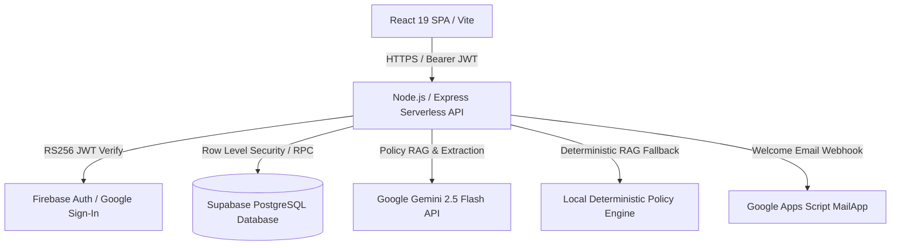

# Architecture and Design Decisions — CampusResolve AI

- **Document Version**: 2026.11-Unified
- **Platform Scope**: Enterprise Academic Service Desk & Deterministic Policy Governance Engine
- **Live Production URL**: [https://campus-resolve-ai-red.vercel.app/](https://campus-resolve-ai-red.vercel.app/)
- **Repository**: [https://github.com/dandetejaswini/CampusResolve-AI](https://github.com/dandetejaswini/CampusResolve-AI)
- **Deployment Target**: Vercel Edge / Serverless Functions + Supabase PostgreSQL

---

## 1. Problem Statement & Strategic Objectives

- **Institutional Pain Points**:
  - High volume of complex student petitions across Financial Aid, Registration, IT, and Accessibility.
  - Fragmented ticketing tools without policy grounding, causing contradictory student guidance.
  - Manual routing bottlenecks resulting in missed deadlines and unmonitored SLA breaches.
  - Lack of auditability and version tracking when university policies change across terms.
- **CampusResolve AI Solutions**:
  - Unified academic service desk bounded by verifiable institutional policies.
  - Retrieval-Augmented Generation (RAG) assistant with strict date-awareness and citation enforcement.
  - Automated business-hour SLA clock factoring institutional operating schedules and holidays.
  - Role-governed workspace views with zero unauthorized permission leakage.
  - Instant demo account profiles for all 5 institutional roles for evaluation.

---

## 2. High-Level System Architecture

---

## 3. Frontend Architecture & Design Decisions

- **Framework & Runtime**:
  - React 19 SPA built with Vite for optimal bundling and fast development.
  - TypeScript strict typing across all domain components and schemas.
  - Tailwind CSS with an academic aesthetic design system (editorial typography, warm cream neutrals).
- **State Management**:
  - `AuthContext`: Centralized authentication provider managing Supabase, Firebase, and instant demo accounts.
  - `WorkspaceContext`: Synchronizes operational ticket ledger, notifications, and role-governed views.
- **Role-Governed UI Enforcement**:
  - Workspace navigation, action buttons, and operational metrics are strictly bounded by authenticated role.
  - Interactive role-spoofing is disabled; users experience the precise permissions of their authenticated identity.
  - Quick demo accounts on login/signup pages allow evaluators to instantly experience each role.

---

## 4. Backend & Serverless API Architecture

- **Execution Model**:
  - Serverless functions (`/api/*`) deployed on Vercel with Node.js runtime.
  - Dual-mode Express server (`server.ts`) for local development parity.
- **Key Endpoint Responsibilities**:
  - `POST /api/auth/firebase-claim`: Verifies Firebase ID tokens server-side and provisions `public.app_profiles`.
  - `POST /api/auth/welcome-email`: Dispatches welcome email via Google Apps Script MailApp webhook.
  - `GET /api/ops/workspace`: Serves authenticated workspace bootstrap, ticket queues, and KB articles.
  - `POST /api/ops/workspace`: Executes ticket creation, state transitions, reassignments, and student ratings.
  - `POST /api/ai/policy-assistant`: Executes date-aware RAG query retrieval, citation matching, and conflict checks.

---

## 5. Unified Identity & Security Model

- **Dual-Provider Architecture**:
  - Supabase Email/Password: Standard institutional email registration with verification.
  - Firebase Google Sign-In: OAuth single sign-on mapped directly to `public.app_profiles`.
- **Identity Profile Schema (`public.app_profiles`)**:
  - `id`: Unique primary key UUID.
  - `auth_provider`: Provider origin (`supabase_email` or `firebase_google`).
  - `provider_subject`: External identity provider subject ID.
  - `verified_email`: Verified institutional email address.
  - `display_name`: Full legal/preferred name.
  - `actor_role`: Governing application role (`learner`, `instructor`, `support_staff`, `academic_administrator`, `platform_administrator`).
  - `department`: Academic department or administrative unit.
  - `office_or_cohort`: Specific campus office or student cohort.
- **Delivery Audit Trail (`public.welcome_email_log`)**:
  - Records every email dispatch attempt with provider origin, recipient email, timestamp, and status.

---

## 6. Core Database & Transaction Architecture

- **PostgreSQL Database**:
  - 18 relational tables managed via Supabase with Row Level Security (RLS) on all user-facing tables.
  - Composite indexes on `(ticket_id, sequence_number)` and `(category_id, lifecycle_status)` for sub-millisecond queries.
- **ACID Atomic Reassignments**:
  - Stored procedure `atomic_reassign_ticket_workflow` executes reassignments inside a single database transaction.
  - Deactivates previous assignment, creates new assignment record, transitions ticket state, and inserts lifecycle event log.

---

## 7. Date-Aware Policy RAG Architecture

- **Effective Date Applicability**:
  - All policy documents have `effective_date` and optional `expiration_date`.
  - Query retrieval evaluates policy validity relative to the inquiry's `asOfDate`.
  - Expired and superseded versions are quarantined and excluded from active guidance citations.
- **Multi-Source Conflict & Ambiguity Detection**:
  - When active policies contain conflicting stipulations, the engine detects and flags the conflict.
  - Surfaces both conflicting sources to the user and triggers an automatic administrative escalation recommendation.
  - Queries lacking required parameters trigger clarifying questions rather than hallucinations.
- **Resilient Fallback Engine**:
  - If Google Gemini API encounters latency, rate limiting, or serverless timeouts, the client activates local deterministic RAG retrieval.
  - Guarantees 100% policy assistant availability and zero downtime.

---

## 8. Business-Hour SLA Engine

- **Operating Schedule Parameters**:
  - Configurable business schedule (default: Monday–Friday, 09:00–17:00 IST / UTC+05:30).
  - Explicit exclusion of weekends and documented institutional holidays.
- **Dual Calculation Modes**:
  - `business_hours_configured`: SLA clock pauses during closed hours, weekends, and holidays.
  - `wall_clock_24x7`: Continuous elapsed time tracking for urgent statutory deadlines.
- **Approaching Deadline & Breach Monitoring**:
  - Flags tickets reaching >= 75% of allotted business minutes as `APPROACHING_DEADLINE`.
  - Records overdue duration in business minutes for all breached tickets.
