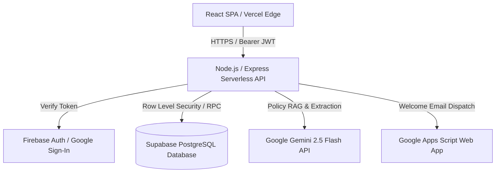

# Architecture and Design Decisions — CampusResolve AI

## 1. Problem Statement and Solution Overview
Higher education institutions face substantial administrative friction handling thousands of student support inquiries across Financial Aid, Registration, IT Support, and Accessibility. Legacy ticketing systems lack policy grounding, leading to inconsistent guidance, SLA breaches, and manual escalation bottlenecks.

**CampusResolve AI** is an enterprise-grade AI-powered academic support and ticket resolution workspace that integrates deterministic policy grounding (RAG), automated business-hour SLA tracking, multi-role RBAC, and secure Supabase PostgreSQL persistence with Firebase authentication.

## 2. High-Level System Architecture

## 3. Frontend Architecture
- Built with React 19, TypeScript, Tailwind CSS, and React Router.
- Structured into modular domain components, custom hooks, and context providers (`AuthContext`, `WorkspaceContext`).
- Strict separation between public marketing pages (Home, About, Features, Contact) and authenticated workspace sections (Dashboard, MyRequests, CreateRequest, AIAssistant, KnowledgeBase, Messages, Notifications, Profile, Settings).

## 4. Backend and API Architecture
- Full-stack Express server (`server.ts`) supporting local development middleware and Vercel serverless functions (`/api/*`).
- API Endpoints:
  - `POST /api/auth/firebase-claim`: Secure server-side Firebase token verification and Supabase profile provisioning.
  - `POST /api/auth/welcome-email`: Authenticated welcome email dispatch via Google Apps Script.
  - `GET /api/ops/workspace`: Operational workspace data bootstrap, ticket listing, metrics, and knowledge base pagination.
  - `POST /api/ops/workspace`: Ticket creation, stage transitions, reassignments, AI policy escalation, and resolution feedback.
  - `POST /api/ai/policy-assistant`: RAG policy retrieval, citation matching, and escalation ticket linking.

## 5. Supabase Database Architecture
- Relational PostgreSQL database managed via Supabase.
- Enforces Row Level Security (RLS) policies on all tables.
- 11 core tables: `roles`, `terms`, `requesters`, `categories`, `policy_documents`, `policy_version_history`, `knowledge_articles`, `policy_article_links`, `tickets`, `ticket_policy_links`, `ticket_article_links`, `ticket_lifecycle_events`, `messages`, `assignments`, `slas`, `resolution_feedbacks`, `ai_retrieval_logs`, `workspace_notifications`.

## 6. Authentication and Authorization Boundaries
- Supports dual authentication: Supabase Email/Password and Firebase Google Sign-In (`campusresolveai`).
- Five Institutional Roles:
  1. **Learner:** Submits requests, views own tickets, reads knowledge base, submits feedback.
  2. **Instructor:** Reviews learner inquiries, cites policies, recommends routing.
  3. **Support Staff:** Triages incoming queues, updates ticket status, assigns teams, posts internal notes.
  4. **Academic Administrator:** Adjudicates policy escalations, reassigns escalated tickets, approves final resolutions.
  5. **Platform Administrator:** Configures system governance, business schedules, SLA rules, and platform evaluation benchmarks.

## 7. SLA and Escalation Workflow
- **SLA Calculation:** Computes target business minutes based on configurable calendars (excluding weekends and official holidays). Tracks `within_sla`, `approaching_deadline`, and `breached`.
- **Escalation Rules:** Automatically triggers escalation when SLA is breached or when complexity exceeds tier-1 staff capability. Requires Academic or Platform Administrator sign-off for final resolution.

## 8. Key Architectural Decisions and Trade-Offs
- **Decision:** Server-side profile provisioning using Supabase Service Role Key (`SUPABASE_SERVICE_ROLE_KEY`).
  * *Reason:* Prevents client-side RLS violations during first-time Google sign-in when JWT claims lack institutional roles.
- **Decision:** Deterministic RAG Fallback.
  * *Reason:* Ensures 100% uptime and test determinism even if Gemini API rate limits or network partitions occur.
